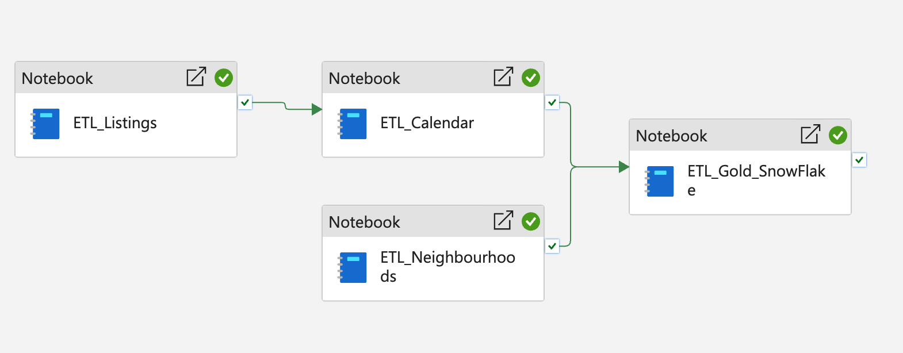
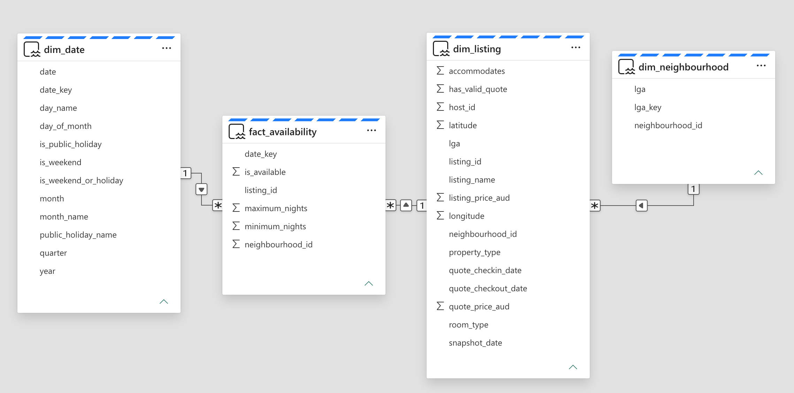

# Melbourne Airbnb — End-to-End Analytics

An end-to-end data engineering and analytics project using **Microsoft Fabric, PySpark and Delta Lake** to transform Airbnb data into a business-ready Snowflake Schema.

**Status:** ETL and data modelling completed | Dashboard and ML planned

## 1. Business Problem

Based on the September 2026 Airbnb snapshot, how do **listing supply, room-type distribution, indicative nightly prices and advertised availability** over the following 90 days vary across Melbourne's local government areas (LGAs)?

## 2. Dataset Overview

**Source:** Inside Airbnb — Melbourne, September 2026

| Metric | Result |
|---|---:|
| Unique Listings | 25,715 |
| LGAs | 30 |
| Analysis Period | 18 Sep – 16 Dec 2026 |
| Calendar Records | 2,314,350 |
| Valid Price Quotes | 19,004 (73.90%) |

## 3. Data Architecture

The project follows a **Medallion Architecture**:

- **Bronze:** Ingest raw Airbnb CSV files.
- **Silver:** Clean, standardise and validate data.
- **Gold:** Build Fact and Dimension tables for analysis.

### Pipeline Workflow

**NB02 Listings → NB01 Calendar → NB04 Gold**

**NB03 Neighbourhoods → NB04 Gold**

NB03 runs independently, while NB04 starts after the required Silver ETL activities succeed. NB05 handles exports separately.

### Gold Snowflake Schema

| Table | Grain |
|---|---|
| `dim_neighbourhood` | One row per LGA |
| `dim_listing` | One row per listing |
| `dim_date` | One row per date |
| `fact_availability` | One row per listing per date |

**Relationships:** `dim_neighbourhood → dim_listing → fact_availability ← dim_date`

The Date Dimension includes weekend and Victorian public holiday indicators.

## 4. Engineering Highlights

- **CSV Parsing:** Fixed embedded line-break issues that initially produced 46,525 incorrectly parsed records.
- **Data Quality:** Validated unique IDs, complete 90-day coverage and Fact–Dimension relationships.
- **Date Selection:** Used the latest Listings snapshot (18 September) to avoid 21,360 missing Listing-Date records in the earlier window.
- **Surrogate Keys:** Preserved existing Neighbourhood IDs using Delta MERGE.

**Validation Result:** 0 duplicate Fact Keys, 0 unmatched dimension keys and complete coverage for all 25,715 listings.

## 5. Project Notebooks

| Notebook | Purpose |
|---|---|
| NB01 — Calendar ETL | Availability cleaning and 90-day validation |
| NB02 — Listings ETL | CSV ingestion, cleaning and pricing fields |
| NB03 — Neighbourhoods ETL | LGA standardisation |
| NB04 — Gold Snowflake | Dimension and Fact Table modelling |
| NB05 — Dashboard Export | Reporting datasets and CSV/Parquet backups |

## 6. Dashboard Data & Limitations

NB05 exports:

| Dataset | Rows |
|---|---:|
| `airbnb_listing_summary.csv` | 25,715 |
| `airbnb_daily_availability.csv` | 7,470 |

**Advertised Availability Rate:**

`SUM(available_listing_days) / SUM(total_listing_days)`

**Limitations:** Advertised availability is not confirmed occupancy or demand. Price quotes are indicative, cover 73.90% of listings and do not represent daily transaction prices. Results reflect a single September 2026 snapshot.

## 7. Next Steps

**Looker Studio Dashboard:** Visualise listing supply, room types, pricing and advertised availability across LGAs.

**Machine Learning:** Explore unsupervised clustering to identify Airbnb listing segments or supervised learning to predict indicative listing prices based on property and geographic features.

---

**Skills:** Microsoft Fabric · PySpark · Delta Lake · ETL · Data Quality · Snowflake Schema · Dimensional Modelling · Data Aggregation